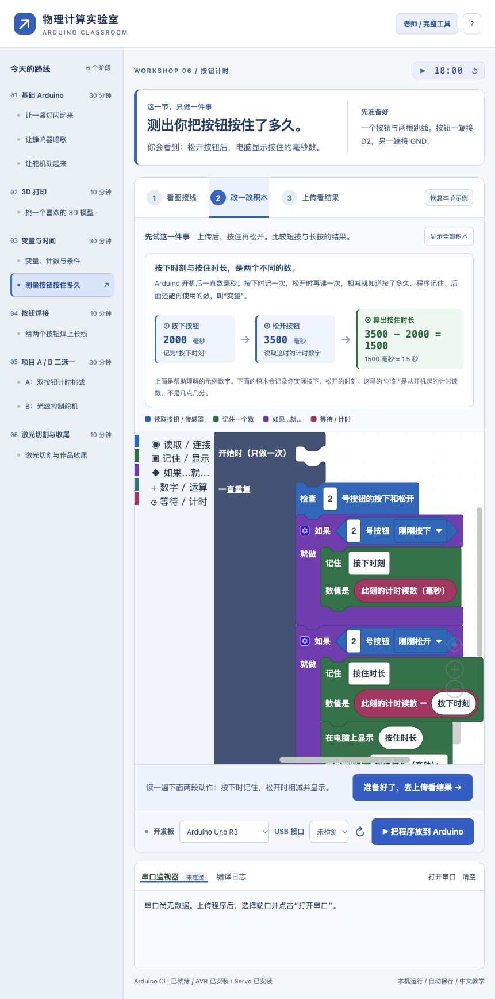
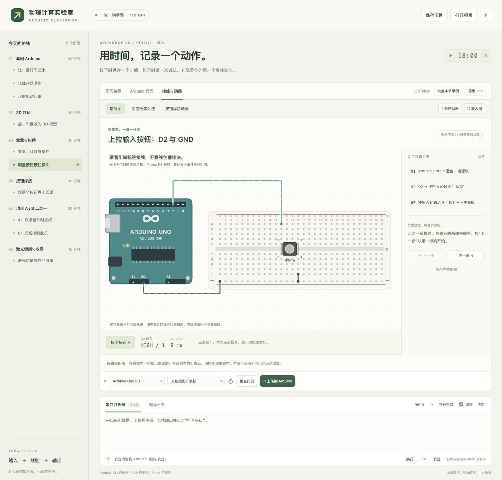

# Arduino 中文课堂

面向第一次接触 Arduino 的学习者：看图接线、修改中文积木，然后把程序上传到真实开发板。课程按 120 分钟安排，覆盖 LED、蜂鸣器、舵机、按钮计时、光线输入，以及打印、焊接和激光切割操作指南。



## 可以做什么

- 中文 Blockly 图形化编程，按课程逐步展示积木；同步生成 Arduino C++，也可直接编辑代码。
- 点击接线步骤高亮导线与面包板孔位；提供按钮焊接分步动画和可操作的计时、光线教学演示。
- 使用 Arduino CLI 检查代码、上传到开发板，查看真实串口输出。
- 自动保存各课进度，导入 / 导出项目 JSON，下载 `.ino` 文件。

支持 **Uno R3、经典 Nano（含旧引导程序）、Mega 2560**。接线图以 Uno R3 为例。

## Mac 一键版（推荐给上课使用）

前往 **[下载最新 Mac 版](https://github.com/EvannnX/arduino-classroom/releases/latest)**，根据“关于本机”里的芯片选择 Apple-Silicon 或 Intel ZIP。

1. 解压 ZIP，把 **Arduino 中文课堂.app** 拖到“应用程序”文件夹，双击打开。
2. 浏览器会自动显示准备页面，首次解包完成后进入课堂。
3. 用 USB 数据线连接 Arduino，选择开发板和串口，即可上传并查看串口输出。

下载包包含 Node.js、Arduino CLI、AVR 核心与 Servo 库，无需另装 Node / npm / Arduino IDE，正常启动无需联网。支持 macOS 11+。停止服务请双击包内的 `停止课堂.command`；关闭浏览器不会停止服务。

应用尚未取得 Apple 开发者签名与公证。首次被拦截时，在“系统设置 → 隐私与安全性”中选择“仍要打开”。Apple 芯片 Mac 若没有 Rosetta，启动页会引导安装 Apple Rosetta（需要联网并确认许可），安装后重新打开。部分第三方板卡仍可能需要其 USB 串口驱动。

## 从源码安装与运行

这是在自己电脑上运行的应用。GitHub 保存源码；GitHub Pages 无法运行本项目所需的本地 Arduino CLI 和串口服务。

先安装 [Node.js](https://nodejs.org/)（22.12+ 或 24+）与 [Arduino CLI](https://docs.arduino.cc/arduino-cli/installation/)，然后在项目目录执行：

```sh
npm ci
arduino-cli core update-index
arduino-cli core install arduino:avr
arduino-cli lib install Servo
npm run build
npm start
```

浏览器打开 **http://127.0.0.1:3765**。macOS 完成安装后可双击 `启动课堂.command`，停止时双击 `停止课堂.command`；Windows / Linux 使用上述命令。

使用 USB 数据线连接板卡，在界面选择开发板和串口，点击上传。上传会替换板上原有程序。没有板卡时仍可学习、接线演示和检查代码；真实上传与串口需要连接设备。

网页资源随构建保存在本地，无需 CDN。首次安装依赖与板卡核心需要联网，Thingiverse / Cuttle 网站入口也需要联网。

## 课程路线

| 时间 | 内容 |
| --- | --- |
| 30 分钟 | Arduino 入门：LED、蜂鸣器旋律、舵机 |
| 10 分钟 | 选模型、切片并启动 3D 打印 |
| 30 分钟 | 串口计数、条件判断、测量按钮按住多久 |
| 10 分钟 | 给两个按钮焊长线 |
| 30 分钟 | 二选一：双按钮用时控制舵机；光线阈值控制舵机 |
| 10 分钟 | 激光切割钥匙扣、取打印件 |

完整操作、接线与教学说明见 [使用说明](使用说明.md)。原始参考课件 PDF 未包含在仓库中。

## 开发与验证

前端在 `src/`，本地服务在 `server.mjs`，由 Express、Blockly、SerialPort 和 Vite 构成。服务仅监听本机。可通过 `CLASSROOM_PORT` 更改端口，通过 `ARDUINO_CLI` 指定 CLI 路径。

```sh
npm run build
# 另一个终端保持 npm start 运行后：
npm test
```

完整测试需要 Arduino CLI、AVR 核心、Servo 库，以及用于行为测试的 C++ 编译器；测试服务使用默认 3765 端口。测试覆盖课程真实编译、电路连接结构、按钮消抖与计时逻辑、积木配色和中文名称兼容，不会上传开发板。

真实烧录、串口收发和物理电路仍需实物验证。接线动画是独立教学演示，实际设备数据在串口监视器中查看。



## 构建 Mac 下载包

在 macOS 构建机准备 Python 3.12+、Node/npm，以及 Rosetta（构建 Intel 包时使用），执行：

```sh
python3 packaging/build-mac.py
node packaging/smoke-mac.mjs releases/Arduino-Classroom-1.0.1-Apple-Silicon.zip
node packaging/smoke-mac.mjs releases/Arduino-Classroom-1.0.1-Intel.zip
```

脚本验证官方 Node / Arduino CLI 的 SHA-256，独立下载 AVR 核心与 Servo 库，生成两个架构的应用与 ZIP；不复制构建者的 Arduino IDE 配置。产物在 `releases/`，不纳入 Git。包内工具首次复制到用户的 `~/Library/Application Support/ArduinoClassroom/`，日志也在该目录。
